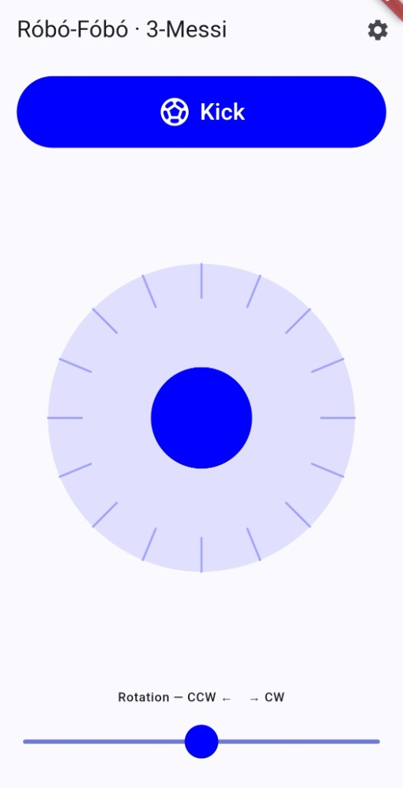
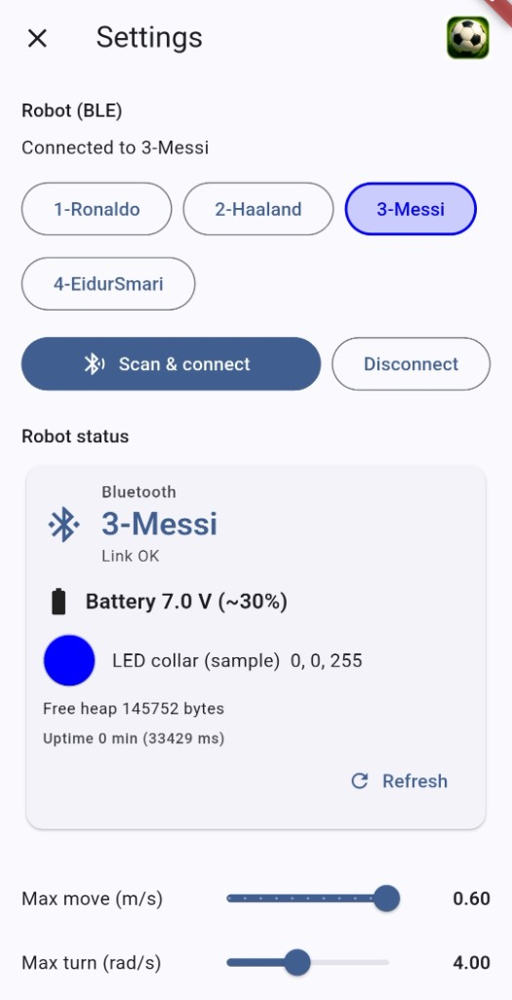
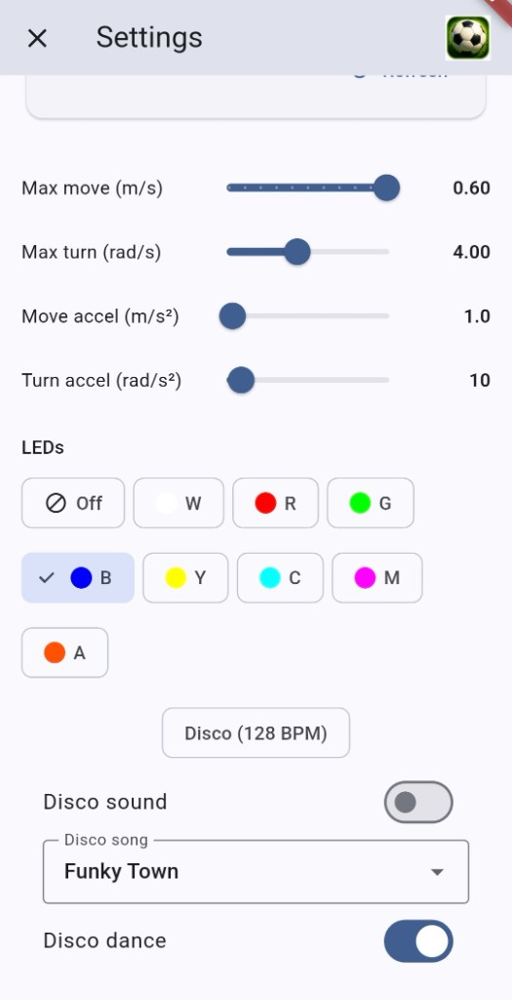

# Róbó-Fóbó (RSK Teleop)

## Présentation (FR)

**Róbó-Fóbó** est une appli Flutter pour piloter les robots **Robot Soccer Kit** en **Bluetooth Low Energy** — pas besoin de Wi‑Fi ni de routeur.

Chaque téléphone se connecte à **un** robot (`1-Ronaldo`, `2-Haaland`, `3-Messi`, `4-EidurSmari`). Le firmware BLE et les réglages (nom, couleur LED en NVS) sont ici : [robo-fobo-firmware](https://github.com/vidarfg/robo-fobo-firmware).

Basé sur le kit ouvert : [robot-soccer-kit/robot-soccer-kit](https://github.com/robot-soccer-kit/robot-soccer-kit).

---

Flutter joystick controller for Robot Soccer Kit robots over **Bluetooth Low Energy** (Android + iOS). No Wi‑Fi / no router.

- **Firmware (BLE):** https://github.com/vidarfg/robo-fobo-firmware  
- **Original Robot Soccer Kit** (design + upstream firmware): https://github.com/robot-soccer-kit/robot-soccer-kit  

## Screenshots

<p align="center">
  
  &nbsp;
  
  &nbsp;
  
</p>

| Teleop | BLE & status | LEDs |
|--------|--------------|------|
| Drive, kick, rotation | Pick robot, scan/connect, battery | Collar presets & disco |

## Download (Android)

Grab the latest **APK** from [Releases](https://github.com/hnykkur/robo-fobo/releases/latest).

On your phone: allow install from that source, then open the APK.

## Run from source

```bash
flutter pub get
flutter run
```

### Connecting

1. Flash the [BLE firmware](https://github.com/vidarfg/robo-fobo-firmware) to each robot.
2. Set the robot number once over USB serial (`115200`): `robotid 1` … `robotid 4`  
   (reboots; advertises as **1-Ronaldo**, **2-Haaland**, **3-Messi**, **4-EidurSmari**).
3. In the app **Settings**, tap **Scan & connect**, or pick the player name.

Grant Bluetooth permissions when prompted.

## Build a release APK

```bash
flutter pub get
flutter build apk --release
```

**Output:** `build/app/outputs/flutter-apk/app-release.apk`

## Protocol

- BLE Nordic UART–style service (see robot firmware `config.h` UUIDs).
- Binary frames **without** dest address octet (firmware address mode off).
- Joystick → **dx / dy** (m/s); rotation bar → **dturn** (rad/s).

## Permissions

- **Android:** `BLUETOOTH_SCAN` / `BLUETOOTH_CONNECT` (and legacy BT + location on older APIs).
- **iOS:** `NSBluetoothAlwaysUsageDescription` in `Info.plist`.

## Credits

Built for use with robots based on the [Robot Soccer Kit](https://github.com/robot-soccer-kit/robot-soccer-kit) open project.
